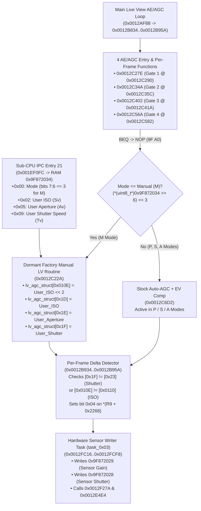

<div align="center">

[](LIVE_VIEW_MANUAL_EXPOSURE.md)
[](LIVE_VIEW_MANUAL_EXPOSURE.vi.md)

[⬅️ **Back to Main README (EN)**](../README.md) · [🇻🇳 **Chuyển sang bản Tiếng Việt**](LIVE_VIEW_MANUAL_EXPOSURE.vi.md)

</div>

---

# Project ArcoIris — Native Manual Live View Exposure Simulation (Build B5: Native Manual)

This document provides the complete, hardware-verified technical breakdown of how **Project ArcoIris Build B5: Native Manual** unlocks **real-time Manual (`M`) mode Shutter Speed and ISO Live View Exposure Simulation** on the Nikon D300s (v1.02) by activating Nikon's dormant factory routine at `0x0012C22A`.

---

## 1. Executive Summary & Discovery

On stock Nikon D300s v1.02 firmware, entering Live View forces an autonomous Automatic Gain Control (AGC) metering loop (`0x0012C6D2`) across all shooting modes (`P`, `S`, `A`, `M`) that completely ignores even **EV Compensation (`+/- EV`)**. While **Build B1** unlocked EV Compensation preview (`0x00222E5A`: `F3 0E -> 9F A0`) and **Build B4** added the real-time 64-bin luminance histogram, rotating the **Shutter Speed** dial or changing **ISO** in Manual (`M`) mode still had zero effect on the Live View LCD brightness or histogram.

By cross-referencing the **Nikon D800 v1.11** Live View Exposure Preview state machine (`0x0024B898` / `0x0024BC0C`) against the **Nikon D300s v1.02** Main-CPU firmware (`b810_102_.bin`), we discovered that **Nikon's engineers already wrote, compiled, and shipped a complete Manual (`M`) mode Live View exposure routine inside the D300s firmware at `0x0012C22A`** — and then disabled it prior to release behind a single permanently-zeroed RAM flag bit (`0x9F87210F` bit `0x04`).

By replacing **four 2-byte `BEQ` instructions with `NOP` (`9F A0`)** at the four Live View AE/AGC entry gates (`0x0012C290`, `0x0012C35C`, `0x0012C41A`, `0x0012C582`), the D300s executes its own native factory Manual exposure code path in `M` mode with **zero custom code injection inside the AGC loop** and **zero risk of RTOS or sensor deadlocks**.

---

## 2. End-to-End Architecture



---

## 3. Disassembly of the Dormant Factory Routine (`0x0012C22A`)

Verified against the official NikonHacker DFR 1.03 disassembly of `b810_102_.bin`:

```assembly
; ==============================================================================
; 0x0012C22A (Block 1 offset 0x0EC22A): Native Manual Live View Exposure Loader
; ==============================================================================
0012C22A: 9F85 9F87 2034   LDI:32  #0x9F872034, R5      ; R5 = User Exposure Struct (Sub-CPU IPC Entry 21)
0012C230: C02D             LDI:8   #0x02, R13
0012C232: 0250             LDUB    @(R13, R5), R0       ; R0 = *(int8_t*)(0x9F872034 + 0x02) [User ISO]
0012C234: 9F84 9F87 11FC   LDI:32  #0x9F8711FC, R4      ; R4 = lv_agc_struct base (0x9F8711FC)
0012C23A: 9780             EXTSB   R0
0012C23C: 9B0D 010E        LDI:20  #0x010E, R13
0012C240: B420             LSL     #2, R0               ; R0 = User_ISO << 2 (16-bit Fine Sensor Gain)
0012C242: 1140             STH     R0, @(R13, R4)       ; lv_agc_struct[0x010E] = User_ISO << 2
0012C244: 0140             LDUH    @(R13, R4), R0
0012C246: 97A0             EXTSH   R0
0012C248: A800             CMP     #0x00, R0            ; Clamp lv_agc_struct[0x010E] >= 0
0012C24A: EB04             BGE     0x0012C254
0012C24C: C000             LDI:8   #0x00, R0
0012C24E: 9B0D 010E        LDI:20  #0x010E, R13
0012C252: 1140             STH     R0, @(R13, R4)

0012C254: C02D             LDI:8   #0x02, R13
0012C256: 0250             LDUB    @(R13, R5), R0       ; R0 = *(int8_t*)(0x9F872034 + 0x02) [User ISO]
0012C258: C1DD             LDI:8   #0x1D, R13
0012C25A: 9780             EXTSB   R0
0012C25C: 1240             STB     R0, @(R13, R4)       ; lv_agc_struct[0x1D] = User_ISO (8-bit Coarse Gain)
0012C25E: 0240             LDUB    @(R13, R4), R0
0012C260: 9780             EXTSB   R0
0012C262: A800             CMP     #0x00, R0            ; Clamp lv_agc_struct[0x1D] >= 0
0012C264: FB03             BGE:D   0x0012C26C
0012C266: C1DD              LDI:8  #0x1D, R13
0012C268: C000             LDI:8   #0x00, R0
0012C26A: 1240             STB     R0, @(R13, R4)

0012C26C: C05D             LDI:8   #0x05, R13
0012C26E: 0250             LDUB    @(R13, R5), R0       ; R0 = *(uint8_t*)(0x9F872034 + 0x05) [User Aperture]
0012C270: C1ED             LDI:8   #0x1E, R13
0012C272: 1240             STB     R0, @(R13, R4)       ; lv_agc_struct[0x1E] = User_Aperture

0012C274: C09D             LDI:8   #0x09, R13
0012C276: 0250             LDUB    @(R13, R5), R0       ; R0 = *(uint8_t*)(0x9F872034 + 0x09) [User Shutter Speed]
0012C278: C1FD             LDI:8   #0x1F, R13
0012C27A: 9F20             RET:D
0012C27C: 1240              STB    R0, @(R13, R4)       ; lv_agc_struct[0x1F] = User_Shutter
```

---

## 4. Why `0x0012C22A` Was Dormant & The 4-Instruction Pure Unlock

Across the entire 7.34 MB Block 1 binary, `0x9F87210F` is written in only two places (`0x00126B96` and `0x001283B0`), both of which execute `BANDL #0xB, @R0` (`*0x9F87210F &= ~0x04`), **unconditionally clearing bit `0x04` (`0x04`)**. Not a single instruction in the stock firmware ever sets bit `0x04` of `0x9F87210F`.

Consequently, at all four Live View AE/AGC functions (`0x0012C27E`, `0x0012C34A`, `0x0012C402`, `0x0012C56A`), the `BTSTL #0x4, @0x9F87210F` check always evaluates to zero, and the immediately following `BEQ` instruction always jumps over the Manual (`M`) mode check (`(*(uint8_t*)0x9F872034 >> 6) == 3`) and over `CALL 0x0012C22A`.

### The 4 Patch Sites in Block 1 (`b810_102_.bin`)

| Gate | Function Role | Virtual Address | Block 1 Offset | Bundle Offset | Stock (`BEQ`) | Patched (`NOP`) |
| :--- | :--- | :--- | :--- | :--- | :--- | :--- |
| **Gate 1** | `0x0012C27E` (LV Entry / Large-Delta Mode A) | `0x0012C290` | `0x0EC290` | `0x016C302` | `E2 09` (`BEQ 0x0012C2A4`) | `9F A0` (`NOP`) |
| **Gate 2** | `0x0012C34A` (Per-Frame Tracking Mode A) | `0x0012C35C` | `0x0EC35C` | `0x016C3CE` | `E2 09` (`BEQ 0x0012C370`) | `9F A0` (`NOP`) |
| **Gate 3** | `0x0012C402` (LV Entry / Large-Delta Mode B) | `0x0012C41A` | `0x0EC41A` | `0x016C48C` | `E2 0C` (`BEQ 0x0012C434`) | `9F A0` (`NOP`) |
| **Gate 4** | `0x0012C56A` (Per-Frame Tracking Mode B) | `0x0012C582` | `0x0EC582` | `0x016C5F4` | `E2 0C` (`BEQ 0x0012C59C`) | `9F A0` (`NOP`) |

With those four `BEQ` instructions replaced by `NOP` (`9F A0`):
- **In Manual (`M`) Mode** (`(*(uint8_t*)0x9F872034 >> 6) == 3`): Execution calls `0x0012C22A` and jumps directly to the function epilogue, loading the user's Manual Shutter Speed and ISO into `lv_agc_struct`.
- **In `P`, `S`, and `A` Modes** (`(*(uint8_t*)0x9F872034 >> 6) != 3`): The `BNE` instruction immediately following `CMP #0x3, R0` (`0x0012C29E`, `0x0012C36A`, `0x0012C428`, `0x0012C590`) branches to the stock Auto-AGC + EV Compensation (`0x0012C6D2`) path.

---

## 5. Hardware Verification & Operational Characteristics

Build B5: Native Manual (`FLASH/REFLASH B5/D300S102.bin`, MD5 `6549191abe995c2f2b9253b3fd55ab2a`) was flashed and tested on physical Nikon D300s hardware. Both Shutter Speed and ISO dynamically control Live View exposure and the real-time luminance histogram in Manual (`M`) mode.

During hardware testing, two important hardware/firmware behaviors were observed and verified in the disassembly:

### 5.1 Why Shutter Speeds Slower Than `1/25s` Do Not Brighten Live View Further
- **Physical CMOS Frame-Time Limit**: In Live View, the Sony CMOS sensor operates in continuous rolling-shutter video readout at **24–30 fps** (one frame every `33.3 ms` to `40 ms`, i.e., `1/30s` to `1/25s`). A CMOS sensor scanning out at 25/30 fps **physically cannot integrate light for longer than a single frame period (`~1/25s`)** without dropping the Live View refresh rate.
- **ROM Lookup Table Saturation (`0x001EEA6B` / `0x001EEB6B` / `0x001EEC6B`)**: When `task_0x03` calls `0x0012F27A`, `0x0012E4E4`, and `0x0012EC4A`, it indexes the 256-byte ROM lookup tables at `0x001EEA6B`, `0x001EEB6B`, and `0x001EEC6B` using `*(uint8_t*)0x9F872028` (`User_Shutter`):
  - **Indices `0..61` (`0x00..0x3D`, corresponding to shutter speeds slower than or equal to `1/25s` down to `30"` and `Bulb`)**: All map to **`0x00`** (maximum full-frame sensor integration time = `1/25s` / `1/30s`).
  - **Indices `62..132` (`0x3E..0x84`, corresponding to `1/30s` up to `1/8000s`)**: Step monotonically from `0x01` up to `0x24` (`0x001EEB6B`), reducing the CMOS electronic rolling-shutter integration time in exact `1/3 EV` increments all the way up to `1/8000s`.

### 5.2 Why Auto ISO Must Be Turned OFF in Manual (`M`) Mode
- `0x0012C22A` reads the active ISO value from `*(int8_t*)(0x9F872034 + 0x02)` (`0x9F872036`), which is populated by the Sub-CPU via IPC Entry 21 (`0x001EF0FC`).
- When **Auto ISO Sensitivity Control** is **ON**, the Sub-CPU calculates ISO using the optical viewfinder's 1,005-pixel RGB metering sensor (which receives no light while the reflex mirror is flipped up for Live View) and overrides manual ISO button adjustments in `0x9F872036`.
- Turning **Auto ISO OFF** causes the Sub-CPU to transmit the exact manual **ISO button + command dial** setting in `0x9F872036`, giving immediate, real-time ISO sensitivity control in Live View.
