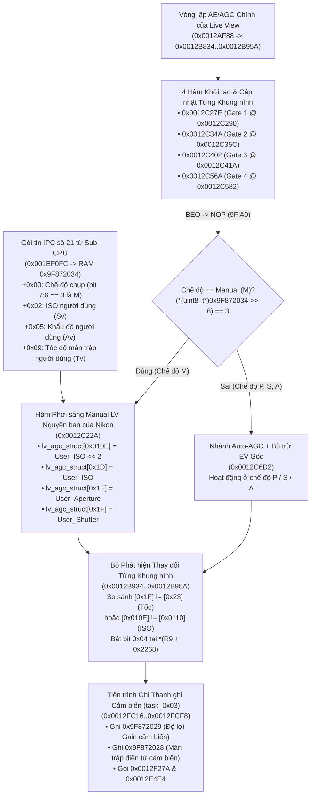

<div align="center">

[](LIVE_VIEW_MANUAL_EXPOSURE.md)
[](LIVE_VIEW_MANUAL_EXPOSURE.vi.md)

[⬅️ **Quay lại Trang Chủ (VI)**](../README.vi.md) · [🇬🇧 **Switch to English Version**](LIVE_VIEW_MANUAL_EXPOSURE.md)

</div>

---

# Project ArcoIris — Phân Tích Kỹ Thuật Cơ Chế Giả Lập Phơi Sáng Live View Chế Độ `M` (Build B5: Native Manual)

Tài liệu này trình bày chi tiết toàn bộ cơ chế kỹ thuật (đã được kiểm chứng trực tiếp trên phần cứng Nikon D300s thực tế) của **Project ArcoIris Build B5: Native Manual**: kích hoạt hàm điều khiển phơi sáng Live View chế độ **Manual (`M`)** nguyên bản bị ẩn của Nikon tại địa chỉ `0x0012C22A`.

---

## 1. Tóm Tắt Phát Hiện Kỹ Thuật

Trên firmware gốc của Nikon D300s (v1.02), khi vào chế độ Live View, máy luôn ép buộc chạy vòng lặp tự động điều chỉnh độ lợi (Auto-AGC) tại `0x0012C6D2` cho tất cả các chế độ chụp (`P`, `S`, `A`, `M`) và thậm chí **không hề phản hồi cả Bù trừ sáng EV (`+/- EV`)**. Dù bản **Build B1** của chúng ta đã mở khóa bù trừ sáng EV (`0x00222E5A`: `F3 0E -> 9F A0`) và **Build B4** bổ sung biểu đồ Histogram độ chói 64 cột thời gian thực, việc xoay bánh xe **Tốc độ màn trập** hoặc thay đổi **ISO** ở chế độ `M` vẫn hoàn toàn không làm thay đổi độ sáng màn hình LCD hay biểu đồ Histogram.

Bằng cách đối chiếu chéo trình quản lý trạng thái Live View Exposure Preview của **Nikon D800 v1.11** (`0x0024B898` / `0x0024BC0C`) với firmware Main-CPU của **Nikon D300s v1.02** (`b810_102_.bin`), chúng tôi phát hiện ra rằng **các kỹ sư của Nikon đã viết, biên dịch và nhúng sẵn toàn bộ hàm nạp thông số phơi sáng thủ công (`M`) cho Live View tại địa chỉ `0x0012C22A`** — nhưng đã vô hiệu hóa nó trước khi phát hành bằng một bit cờ RAM luôn bị xóa về `0` (`0x9F87210F` bit `0x04`).

Chỉ cần thay thế **4 lệnh nhảy có điều kiện `BEQ` (2 byte mỗi lệnh) bằng lệnh `NOP` (`9F A0`)** tại 4 cổng vào AE/AGC của Live View (`0x0012C290`, `0x0012C35C`, `0x0012C41A`, `0x0012C582`), chiếc D300s sẽ chạy chính xác nhánh code điều khiển phơi sáng `M` nguyên bản của hãng mà **không cần chèn bất kỳ đoạn code tùy chỉnh nào vào giữa vòng lặp AGC**, loại bỏ hoàn toàn nguy cơ xung đột RTOS hay treo gương lật.

---

## 2. Sơ Đồ Kiến Trúc Toàn Trình



---

## 3. Mã Máy Hợp Ngữ (Disassembly) Của Hàm `0x0012C22A`

Đã kiểm chứng đối chiếu trực tiếp với bản dịch ngược chuẩn NikonHacker DFR 1.03 của `b810_102_.bin`:

```assembly
; ==============================================================================
; 0x0012C22A (Offset 0x0EC22A trong Block 1): Hàm Nạp Phơi Sáng Manual Live View
; ==============================================================================
0012C22A: 9F85 9F87 2034   LDI:32  #0x9F872034, R5      ; R5 = Cấu trúc Phơi sáng từ Sub-CPU (IPC Entry 21)
0012C230: C02D             LDI:8   #0x02, R13
0012C232: 0250             LDUB    @(R13, R5), R0       ; R0 = *(int8_t*)(0x9F872034 + 0x02) [User ISO]
0012C234: 9F84 9F87 11FC   LDI:32  #0x9F8711FC, R4      ; R4 = Địa chỉ nền lv_agc_struct (0x9F8711FC)
0012C23A: 9780             EXTSB   R0
0012C23C: 9B0D 010E        LDI:20  #0x010E, R13
0012C240: B420             LSL     #2, R0               ; R0 = User_ISO << 2 (Gain tinh 16-bit)
0012C242: 1140             STH     R0, @(R13, R4)       ; lv_agc_struct[0x010E] = User_ISO << 2
0012C244: 0140             LDUH    @(R13, R4), R0
0012C246: 97A0             EXTSH   R0
0012C248: A800             CMP     #0x00, R0            ; Giới hạn dưới lv_agc_struct[0x010E] >= 0
0012C24A: EB04             BGE     0x0012C254
0012C24C: C000             LDI:8   #0x00, R0
0012C24E: 9B0D 010E        LDI:20  #0x010E, R13
0012C252: 1140             STH     R0, @(R13, R4)

0012C254: C02D             LDI:8   #0x02, R13
0012C256: 0250             LDUB    @(R13, R5), R0       ; R0 = *(int8_t*)(0x9F872034 + 0x02) [User ISO]
0012C258: C1DD             LDI:8   #0x1D, R13
0012C25A: 9780             EXTSB   R0
0012C25C: 1240             STB     R0, @(R13, R4)       ; lv_agc_struct[0x1D] = User_ISO (Gain thô 8-bit)
0012C25E: 0240             LDUB    @(R13, R4), R0
0012C260: 9780             EXTSB   R0
0012C262: A800             CMP     #0x00, R0            ; Giới hạn dưới lv_agc_struct[0x1D] >= 0
0012C264: FB03             BGE:D   0x0012C26C
0012C266: C1DD              LDI:8  #0x1D, R13
0012C268: C000             LDI:8   #0x00, R0
0012C26A: 1240             STB     R0, @(R13, R4)

0012C26C: C05D             LDI:8   #0x05, R13
0012C26E: 0250             LDUB    @(R13, R5), R0       ; R0 = *(uint8_t*)(0x9F872034 + 0x05) [User Aperture]
0012C270: C1ED             LDI:8   #0x1E, R13
0012C272: 1240             STB     R0, @(R13, R4)       ; lv_agc_struct[0x1E] = User_Aperture

0012C274: C09D             LDI:8   #0x09, R13
0012C276: 0250             LDUB    @(R13, R5), R0       ; R0 = *(uint8_t*)(0x9F872034 + 0x09) [User Shutter Speed]
0012C278: C1FD             LDI:8   #0x1F, R13
0012C27A: 9F20             RET:D
0012C27C: 1240              STB    R0, @(R13, R4)       ; lv_agc_struct[0x1F] = User_Shutter
```

---

## 4. Giải Thích Hai Hiện Tượng Vật Lý & Phần Cứng Trên Máy Thực Tế

### 4.1 Tại Sao Tốc Độ Màn Trập Chậm Hơn `1/25s` Không Làm Màn Hình Sáng Thêm?
- **Giới hạn vật lý của chu kỳ quét cảm biến CMOS (24–30 fps)**: Khi chạy Live View, cảm biến CMOS quét và xuất khung hình liên tục ở tốc độ **24–30 khung hình/giây** (`33.3 ms` đến `40 ms` mỗi khung hình, tương đương `1/30s` đến `1/25s`). Về mặt vật lý, một cảm biến đang xuất video trực tiếp ở tốc độ 25/30 fps **không thể tích hợp ánh sáng cho một khung hình lâu hơn chính chu kỳ của khung hình đó (`~1/25s`)**.
- **Bảng tra cứu (LUT) 256-byte trong ROM (`0x001EEA6B`, `0x001EEB6B`, `0x001EEC6B`)**:
  - Khi `task_0x03` (`0x0012FC16`) gọi các hàm nạp thanh ghi cảm biến `0x0012F27A`, `0x0012E4E4` và `0x0012EC4A`, trình điều khiển dùng byte tốc độ màn trập `*(uint8_t*)0x9F872028` để tra bảng ROM tại `0x001EEB6B`:
    - **Index `0..61` (`0x00..0x3D`, ứng với mọi tốc độ chậm hơn hoặc bằng `1/25s` xuống tới `30"` và `Bulb`)**: Toàn bộ đều có giá trị **`0x00`** (thời gian phơi sáng tối đa của một khung hình Live View = `1/25s` / `1/30s`).
    - **Index `62..132` (`0x3E..0x84`, ứng với tốc độ từ `1/30s` lên tới `1/8000s`)**: Tăng đều đặn từ `0x01` lên `0x24`, khép dần màn trập điện tử theo đúng từng bước `1/3 EV` cho tới tận `1/8000s`.

### 4.2 Tại Sao Cần TẮT Auto ISO Khi Chụp Chế Độ `M` Trong Live View?
- Hàm `0x0012C22A` đọc byte ISO trực tiếp tại `*(int8_t*)(0x9F872034 + 0x02)` (`0x9F872036`) từ gói tin IPC Entry 21 do Sub-CPU gửi sang.
- Khi bật **Auto ISO Sensitivity Control**, Sub-CPU tự động tính toán ISO dựa trên cảm biến đo sáng quang học 1.005 pixel nằm trên gù ngắm (vốn bị gương lật che tối đen khi đang bật Live View) và ghi đè giá trị đó vào `0x9F872036`.
- Khi **TẮT Auto ISO**, Sub-CPU truyền chính xác giá trị ISO bạn chọn bằng **nút ISO + bánh xe lệnh** vào `0x9F872036`, giúp điều khiển độ lợi ISO của cảm biến Live View tức thời theo thời gian thực.
