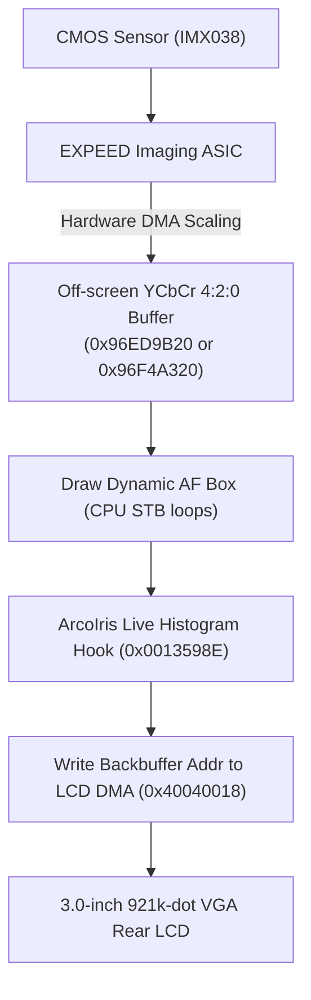

# Project ArcoIris — Live View Architecture & Pipeline

This document details the reverse engineering of the Nikon D300s Live View display subsystem (`0x00134E28` – `0x00135C5C`), buffer allocation, and tear-free OSD injection mechanism.

---

## 1. Frame Flow & Timing

When Live View is engaged, the camera enters a continuous display loop running at ~30–60 FPS:



1. **Hardware Scaling**: The imaging ASIC captures sensor lines, applies digital gain and white balance, downsamples to `640 × 426`, and DMA-transfers planar YCbCr 4:2:0 into off-screen SDRAM.
2. **Dynamic Overlays**: The CPU renders dynamic graphics (such as the contrast-detect autofocus rectangle) directly into the off-screen buffer using store-byte (`STB`) loops.
3. **Buffer Flip Hook (`0x0013598E`)**:
   - Stock instruction at `0x0013598E` (Block 1 offset `1:0x0F598E`):
     ```assembly
     LDI:32  #0x40040018, R12
     ST      R0, @R12             ; write backbuffer ptr to LCD DMA
     ```
   - At this precise point, `R0` contains the 32-bit SDRAM address of the completed frame (`0x96ED9B20` or `0x96F4A320`).
   - Project ArcoIris replaces these 8 bytes with a call to the code cave at `0x002D2C00`. The histogram routine draws into the backbuffer, executes the displaced `ST R0, @R12`, and returns cleanly.
   - Result: **100% tear-free, flicker-free rendering** with zero display artifacts.

---

## 2. Buffer Memory Organization

Each Live View frame uses planar YCbCr 4:2:0:

| Plane | Offset from Base | Stride | Active Resolution |
| :--- | :--- | :--- | :--- |
| **Y (Luminance)** | `+0x00000` | 640 bytes/row | $640 \times 426$ px |
| **Cb (Blue Chroma)** | `+0x4B000` | 320 bytes/row | $320 \times 213$ px |
| **Cr (Red Chroma)** | `+0x5DC00` | 320 bytes/row | $320 \times 213$ px |

The rear LCD has a physical resolution of $640 \times 480$.
- Lines `y = 0 .. 425` display the active sensor image.
- Lines `y = 426 .. 479` (bottom 54 rows) display the Nikon OSD status bar (shutter speed, aperture, ISO, exposure meter).

---

## 3. OSD Layout & Collision-Free Coordinate Zone

To ensure the Live Histogram does not conflict with any stock UI elements, all Live View overlays were mapped from the coordinate tables at `0x00210B00..0x00210E80`:

| Screen Element | Coordinate Bounding Box | Collision Avoided |
| :--- | :--- | :--- |
| Framing Grid Lines | $x = 160, 320, 480$; $y = 106, 213, 320$ | ✅ Placed within cell $(x < 156, y > 322)$ |
| 16:9 Movie Crop Bar | $y = 393 .. 425$ | ✅ Placed above $y = 392$ |
| Bottom Status Bar | $y = 426 .. 479$ | ✅ Placed strictly above $y = 426$ |
| Zoom Navigation Box | $x = 472 .. 632, y = 364 .. 472$ | ✅ Placed on opposite (left) side |
| Audio Microphone Meter | $x = 608 .. 640, y = 160 .. 360$ | ✅ Placed on opposite (left) side |

### Chosen Histogram Geometry
- **Left**: $x = 16$
- **Right**: $x = 147$ (Width: 132 px)
- **Top**: $y = 324$
- **Bottom**: $y = 391$ (Height: 68 px)
- **Active Bar Baseline**: $y = 389$, height: up to 64 pixels.
