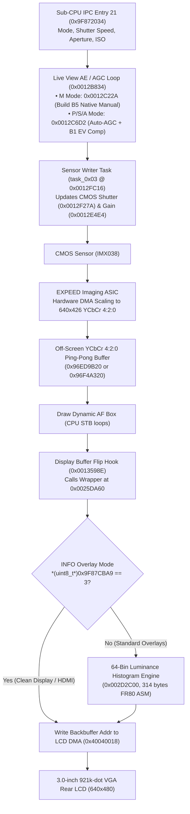

# Project ArcoIris — Live View Architecture & Display Pipeline

This document details the reverse engineering of the Nikon D300s Live View display subsystem (`0x00134E28` – `0x00135C5C`), YCbCr 4:2:0 framebuffer layout, `INFO`-button overlay visibility control, and tear-free OSD injection mechanism used in **Builds B4 and B5: Native Manual**.

---

## 1. Frame Flow & End-to-End Pipeline

When Live View is active, the camera runs a continuous sensor-to-LCD pipeline at 24–30 FPS:



1. **Exposure & Sensor Programming**:
   - In **Manual (`M`) mode** (**Build B5**), `0x0012C22A` loads the user's Shutter Speed (`0x9F87203D`) and ISO (`0x9F872036`) into `lv_agc_struct` (`0x9F8711FC`).
   - In **`P`, `S`, `A` modes** (**Build B1**), `0x0012C6D2` runs Automatic Gain Control biased by the user's EV Compensation (`+/- EV`).
   - Whenever Shutter Speed or ISO changes, `task_0x03` (`0x0012FC16`) programs the CMOS sensor's electronic shutter and gain registers in real time.
2. **Hardware Scaling**: The EXPEED imaging ASIC captures sensor readout lines, applies white balance and tone curves, scales the image to `640 × 426`, and DMAs planar YCbCr 4:2:0 into the inactive off-screen SDRAM backbuffer (`0x96ED9B20` or `0x96F4A320`).
3. **Buffer Flip Hook (`0x0013598E` → `0x0025DA60` → `0x002D2C00`)**:
   - Stock instruction at `0x0013598E` (Block 1 offset `0x0F598E`):
     ```assembly
     LDI:32  #0x40040018, R12
     ST      R0, @R12             ; write completed backbuffer ptr to LCD DMA
     ```
   - At this point, `R0` holds the 32-bit SDRAM address of the completed off-screen frame (`0x96ED9B20` or `0x96F4A320`).
   - Project ArcoIris redirects `0x0013598E` to the wrapper at `0x0025DA60`, which checks `*(uint8_t*)0x9F87CBA9` (the Live View `INFO` button overlay mode). Unless the user has cycled `INFO` to the clean display mode (`0x03`), it invokes the 64-bin histogram engine at `0x002D2C00` to render directly into the off-screen backbuffer *before* writing `R0` to `0x40040018`.
   - Result: **100% tear-free, flicker-free rendering** that directly reflects real-time Manual Shutter Speed, ISO, and EV Compensation changes.

---

## 2. Buffer Memory Organization

Each Live View frame uses planar YCbCr 4:2:0 in SDRAM:

| Plane | Offset from Base | Stride | Active Resolution |
| :--- | :--- | :--- | :--- |
| **Y (Luminance)** | `+0x00000` | `640` bytes/row | `640 × 426` px |
| **Cb (Blue Chroma)** | `+0x4B000` | `320` bytes/row | `320 × 213` px |
| **Cr (Red Chroma)** | `+0x5DC00` | `320` bytes/row | `320 × 213` px |

The rear VGA LCD has a physical resolution of `640 × 480`:
- Rows `y = 0 .. 425` display the live sensor image (`640 × 426`).
- Rows `y = 426 .. 479` (bottom 54 rows) display the Nikon OSD status bar (shutter speed, aperture, ISO, exposure indicator, remaining frames).

---

## 3. OSD Layout & Collision-Free Coordinate Zone

To ensure the Live Histogram does not collide with stock UI widgets, all Live View overlays were mapped from the coordinate tables at `0x00210B00..0x00210E80`:

| Screen Element | Coordinate Bounding Box | Collision Avoided |
| :--- | :--- | :--- |
| Framing Grid Lines | `x = 160, 320, 480`; `y = 106, 213, 320` | ✅ Fits inside bottom-left cell (`x < 156, y > 322`) |
| 16:9 Movie Crop Bar | `y = 393 .. 425` | ✅ Placed above `y = 392` |
| Bottom Status Bar | `y = 426 .. 479` | ✅ Placed strictly above `y = 426` |
| Zoom Navigation Box | `x = 472 .. 632, y = 364 .. 472` | ✅ Placed on opposite (left) side |
| Audio Microphone Meter | `x = 608 .. 640, y = 160 .. 360` | ✅ Placed on opposite (left) side |

### Histogram Bounding Box Geometry
- **Left**: `x = 16`
- **Right**: `x = 147` (Width: `132` px)
- **Top**: `y = 324`
- **Bottom**: `y = 391` (Height: `68` px)
- **Active Bar Baseline**: `y = 389`, maximum bar height: `64` px (`64` bins × `2` px width = `128` px interior).
